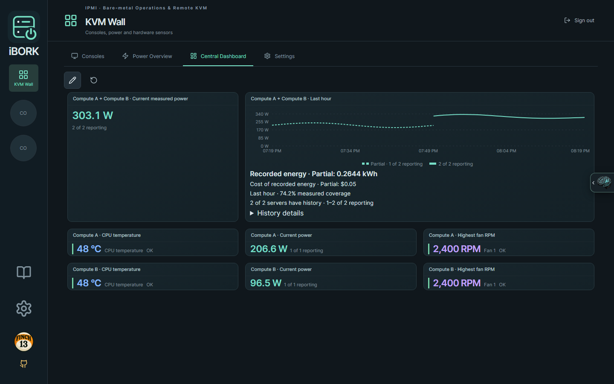
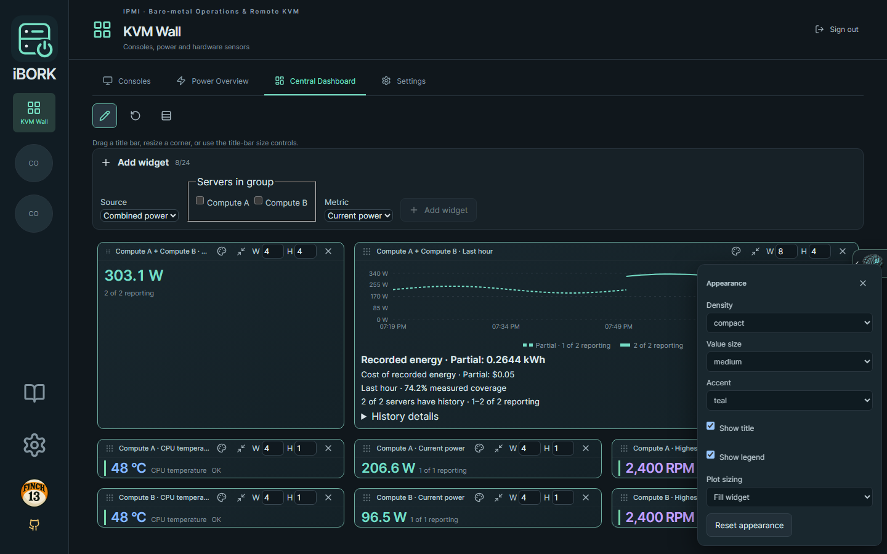
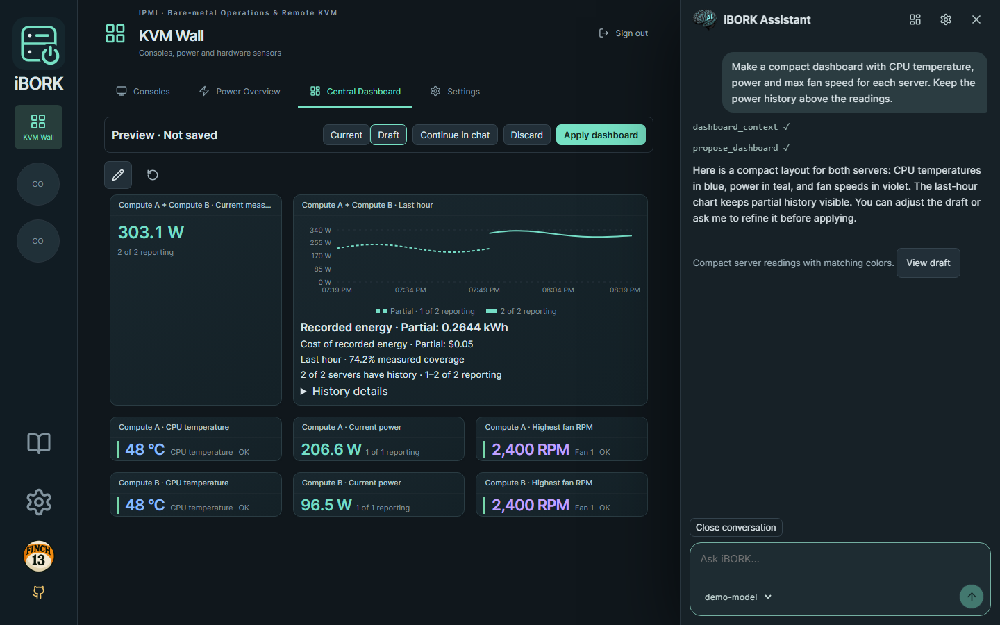

# iBORK

**IPMI · Bare-metal Operations & Remote KVM**
_Less bork. More uptime._ — by Finch13

iBORK brings remote consoles, hardware sensors, power history and server controls into one self-hosted web workspace. Connect the providers you have, arrange your own dashboards, and optionally use an AI assistant to help set things up and design the layout. JetKVM uses its stock firmware.

[Operator guide](docs/usage.md) · [Deployment](docs/deployment.md) · [Releases](https://github.com/akira69/iBORK/releases) · [Touchscreen firmware](https://github.com/akira69/iBORK-ESP32)



_Actual iBORK interface with simulated telemetry. The screenshots below also use demo data; the Assistant conversation is scripted to illustrate the preview workflow._

## What's included

| Area                 | What you can do                                                                                                                                                                             |
| -------------------- | ------------------------------------------------------------------------------------------------------------------------------------------------------------------------------------------- |
| Remote consoles      | Use stock JetKVM, VNC or supported Comet KVM connections. View several consoles in the KVM Wall, enlarge one, and select it for keyboard and mouse input.                                   |
| Server management    | Use IPMI power controls, one-time boot selection, events, inventory and Serial over LAN where supported. Cooling controls depend on the board and provider.                                 |
| Hardware telemetry   | Read IPMI or Glances v4 temperatures and fan speeds. Guided setup can connect Glances through an SSH tunnel.                                                                                |
| Power and cost       | Track current watts, recorded energy and electricity cost from BMC power readings, MQTT outlets, or Home Assistant power entities, including Matter outlets exposed through Home Assistant. |
| Custom dashboards    | Drag and resize widgets on server and fleet dashboards; combine multiple servers' power readings, add individual measurements, and place KVM widgets on the Central Dashboard.              |
| Widget styling       | Choose compact or comfortable density, value size, accent color, title/legend visibility and power-plot height. Small measurements can fit in a single grid row.                            |
| Optional AI          | Use built-in chat or an external MCP client to discover devices, draft connections, and propose dashboard layouts and styling for review. Manual setup remains available.                   |
| Optional touchscreen | Pair an Elecrow CrowPanel DIS08070H V3 display for selected server readings, a shared brightness schedule, local manual brightness and PIN-protected power requests.                        |

Available tools follow each server's configured providers. A standalone KVM does not need IPMI, and a telemetry-only server does not need a KVM.

## How it works

The Go service serves the web UI, connects to your management and telemetry providers, and records power history locally. Your browser displays the workspace and handles console interaction. Deploy it on a trusted management network with HTTPS for network access; see the [deployment guide](docs/deployment.md) for reverse-proxy, service and container setup.

1. Sign in and add a server under **iBORK settings → Add server**. Configure only the connections it needs, then verify them.
2. Open its workspace for console, sensors and management tools, or use **KVM Wall** for consoles and fleet views.
3. Use **Edit layout** to add, move and resize widgets. Open a widget's **Appearance** palette to style it. Power plots can fill their widget or use a fixed height independently of the outer card.
4. Set your electricity rate in iBORK settings. Power history retains 30 days of samples. Fleet history uses available measurements when a server stops reporting, labels partial energy and cost, and shows coverage and gaps. Missing readings are never counted as zero.



Connection settings and power history live on the server. Dashboard layouts, display names and shortcuts are saved in the current browser. An unsaved AI draft is temporary: apply it to keep it; reloading or signing out discards it.

## AI support: chat, preview and MCP

AI is optional. Open the brain tab at the right edge, then the Assistant settings gear. Configure an **OpenAI-compatible `/v1` endpoint** and a model that supports tool calling; a compatible local Ollama model can also be used. Use **Test & save model** to validate the connection. The conversation's model picker can select another available model.

The Assistant uses the current dashboard and available readings as context. For example:

- “Add CPU temperature, power draw and the highest fan speed for each server.”
- “Make these readings compact, use blue for temperatures, and put the power history above them.”
- “Make the power plot taller and hide its legend.”



Dashboard proposals appear as an **unsaved preview using the real widgets**. Compare **Current** and **Draft**, refine it in chat, or adjust it manually. **Apply dashboard** saves the result; **Discard** restores the saved layout. This works across server and fleet dashboards, including the KVM Wall; fixed dashboards retain their required widgets and device bindings. Hardware controls and console input are inactive in a preview.

**Close conversation** returns to the starter buttons and clears the conversation context while keeping the selected model and any dashboard draft. The header **×** simply hides the Assistant.

For an external AI client, enable temporary **MCP** access in Assistant settings over HTTPS and copy the connection configuration. Chat and MCP use the same tools, validation and dashboard styling guidance. Keep the browser Assistant open to review incoming proposals; applying a layout remains a browser action. Access expires within 15 minutes and can be revoked. Network discovery requires an explicit private-network scope.

Messages and relevant device, sensor and layout context are sent to your configured AI provider. Enter device credentials in the connection forms. See the [Assistant walkthrough](docs/usage.md#ibork-assistant) for setup, discovery, MCP and preview details.

## Touchscreen display

The companion [ESP32 firmware](https://github.com/akira69/iBORK-ESP32) runs on the supported 800 × 480 CrowPanel. Pair it with iBORK, select servers and detail widgets under **Remote display**, and use the browser preview to check the layout.

On the panel, **Settings → Display** offers 10–100% manual brightness, a separate contrast slider, and clock controls. Choose **Use schedule** to return to the shared daily schedule. Supported power-on and graceful-shutdown requests require PIN confirmation. See the [touchscreen operator guide](docs/usage.md#touchscreen-display) and [display provisioning and API](docs/panel-api.md).

## Quick start

Build with Node.js 24 and Go 1.27.3 or newer. The Go executable embeds the web UI.

```sh
(cd web && npm ci && npm run build)
mkdir -p dist
go build -trimpath -o dist/jet-supermicro .
```

For a local evaluation on Linux or macOS, create a private state directory and a dashboard password hash. The hash command prompts for the password.

```sh
umask 077
mkdir -p "$HOME/.local/state/ibork/settings"
export STATE_DIRECTORY="$HOME/.local/state/ibork"
export APP_PASSWORD_HASH_FILE="$STATE_DIRECTORY/bootstrap-password-hash"
./dist/jet-supermicro hash-password > "$APP_PASSWORD_HASH_FILE"
./dist/jet-supermicro
```

Open **http://localhost:8080**, sign in, and choose **iBORK settings → Add server**. For network access, configure HTTPS and an exact external origin. Restrict access to people and networks authorized to manage your hardware.

## Development

```sh
(cd web && npm ci && npm run lint && npm test && npm run build)
go test ./...
go vet ./...
```

See the [vendored dependency notes](docs/vendor-patches.md) before regenerating Go dependencies. iBORK is licensed under [GPL-2.0](LICENSE). [Third-party notices](THIRD_PARTY_NOTICES.md) cover dependencies and bundled assets.
